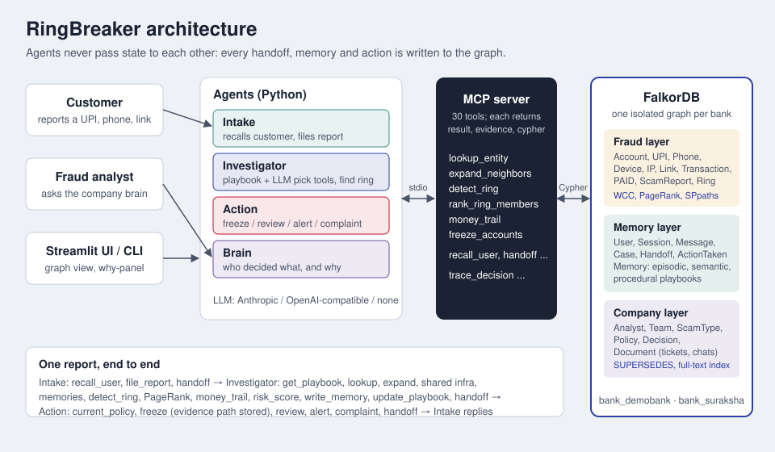

# RingBreaker


**A customer reports one scam payment. Agents follow the bank's graph to the whole ring behind it, freeze what the policy allows, and keep the evidence for every step.**

Built for *Graph Hacks: Context for AI Agents* (FalkorDB). One project, entered in all three tracks:

| Track | What RingBreaker does |
|---|---|
| **01 Agents that act on connected data** | Investigator agent picks graph tools over MCP: multi-hop expansion, shared-infrastructure search, ring detection (`algo.WCC` + `algo.labelPropagation`), PageRank to find the collector, `algo.SPpaths` money trails, explainable risk scores. Action agent freezes accounts under the current policy and stores the evidence path and Cypher for every freeze. |
| **02 Agent memory and coordination** | Intake, Investigator, Action and Brain agents share state only through the graph (handoffs, case state, actions). Episodic memory (what a customer reported), semantic memory (device D17 belongs to a ring), procedural memory (investigation playbooks that get better after each case). Persistent conversation history. One isolated graph per bank. Tested with concurrent cases. |
| **03 Company brain** | Analysts, teams, scam expertise, policies (with `SUPERSEDES`), decisions, tickets and chats in the same graph as the fraud data. "Why was ACC-5530 frozen and who approved it?" gets an answer with the analyst, approver, policy, the newer policy that replaced it, and the source ticket. Agent decisions land in the same graph, so the brain can explain those too. |



## The problem

When a victim reports a scam, a bank usually looks up one UPI ID and blocks one account. By then the money has hopped through two or three mule accounts to a collector. Other victims' reports about the same group sit in the backlog, unconnected, because each one mentions a different UPI ID, phone number or link.

The connection is in the relationships: mule accounts share phones, devices and IPs; money flows from victims to fronts to layers to one collector. That is a graph question, so RingBreaker puts it in a graph.

## What happens when Priya reports `hr.jobs2026@fakepay`

1. **Intake** recalls Priya from the graph, logs the conversation, files the report, opens a case and hands it to the Investigator.
2. **Investigator** loads its playbook (procedural memory) and works the graph:
   `hr.jobs2026@fakepay` → `ACC-3302` → device `D17` → 6 more accounts (3 hops). `algo.WCC` over shared infrastructure gives the full ring of 13; `algo.labelPropagation` on the money graph agrees; PageRank on `PAID` edges names `ACC-7781` as the collector; `algo.SPpaths` traces the money; every member gets a risk score made of named factors. It writes what it learned (D17 belongs to the ring) and improves its playbook.
3. **Action** reads the current freeze policy from the graph (`P-09`, which replaced `P-07`): 12 accounts at risk 70+ are frozen, each with its evidence path; one low-activity recruit (risk 55) goes to human review with Arjun M., the analyst who knows job scams. Nine other customers who paid the ring are alerted; a cyber-crime complaint draft is prepared.
4. **Intake** reads the case back from the graph and replies to Priya.

**Next day** a new account appears on the same device D17 and calls Priya from `+91-90000-41177`. Intake remembers her; the Investigator's improved playbook checks memories on shared devices and recognises D17; the known ring grows by one; the new account is frozen. Total time: under a second per case.

## Run it (5 commands)

```bash
pip install -r requirements.txt
./run.sh up        # FalkorDB via Docker (falls back to the falkordblite package if Docker isn't running)
./run.sh seed      # generate synthetic data and load two banks
./run.sh demo      # the three scenarios in the terminal
./run.sh app       # the web UI at http://localhost:8501
```

`./run.sh test` runs the tests (scenarios end to end through MCP, five concurrent cases, LLM tool-loop, tenant isolation, freeze guardrail).

### LLM or no LLM

Copy `.env.example` to `.env`.

- `LLM_PROVIDER=none` (default): agents follow their graph playbooks deterministically. Same tools, same MCP calls. Good for a repeatable demo with no API key.
- `LLM_PROVIDER=anthropic` or `openai` (any OpenAI-compatible endpoint: Groq, Ollama, OpenRouter...): the Investigator and Brain let the model choose tools from the MCP tool list. Guardrails stay in the graph: the Investigator can't call action tools, and `freeze_accounts` refuses anything below the current policy threshold or anything waiting for human review.

### Use the tools from any MCP client

```bash
python -m mcp_server.server            # stdio
python -m mcp_server.server --http     # streamable HTTP on :8765
```


## How the graph drives decisions

| Decision | Where it comes from |
|---|---|
| Which accounts are in the ring | `algo.WCC` over `Account/Device/IP/Phone` with `USED_DEVICE/LOGGED_IN_FROM/REGISTERED_PHONE` |
| Is it really one group? | `algo.labelPropagation` over `PAID` (money community agreement) |
| Who is the ringleader | `algo.pageRank('Account', 'PAID')` inside the ring |
| How the money moved | `algo.SPpaths` over `PAID` |
| Why an account was frozen | `algo.SPpaths` with `relDirection: 'both'` from the reported entity to the account, stored on the `ActionTaken` |
| The freeze threshold | the current `Policy {topic: 'freeze'}`, following `SUPERSEDES` |
| Who reviews medium-risk accounts | an `Analyst` who is `EXPERT_IN` the case's `ScamType` with the fewest open reviews |
| What to do first next time | the latest procedural `Memory` (playbook) for that scam type |

Every tool returns `{result, evidence: {nodes, edges}, cypher}`, so the UI can draw exactly what a tool saw and show the queries it ran.

FalkorDB notes we verified (`CALL dbms.procedures()` on FalkorDB 4.18): `algo.pageRank`, `algo.WCC`, `algo.labelPropagation`, `algo.betweenness`, `algo.SPpaths`, `algo.SSpaths`, `algo.BFS` are available; undirected `shortestPath()` isn't, so evidence paths use `algo.SPpaths({relDirection: 'both'})`.

## Graph model

- **Fraud**: `Account`, `UPI`, `Phone`, `Device`, `IP`, `Link`, `Transaction`, `ScamReport`, `Ring`; `PAID` is a projection of `Account-SENT->Transaction-TO->Account` so algorithms can run on account-to-account money edges.
- **Memory and coordination**: `User`, `Session`, `Message`, `Case`, `Handoff`, `ActionTaken`, `Agent`, `Memory {kind: episodic|semantic|procedural}`.
- **Company**: `Analyst`, `Team`, `ScamType`, `Policy`, `Decision`, `Document` (tickets, chats, runbooks; full-text indexed).
- **Tenants**: `bank_demobank` and `bank_suraksha` in one FalkorDB instance.

## Data

All synthetic (`data/generate.py`, seeded): 2,000 normal customers with households and merchants as realistic noise, 5 planted scam rings (job, KYC, investment, fake customer care, loan app), 48 backlog reports, 8 analysts, 6 policies, 31 past decisions with source tickets and chats. Phone numbers are `+91-90000-XXXXX`, handles use `@fakepay`/`@demobank`, domains use the reserved `.example` TLD, IPs are in `10.0.0.0/8`.

## Repo

```
data/generate.py       synthetic banks + 3 planted demo scenarios
graph/schema.py        indexes
graph/load.py          loader, PAID projection, scenario-2 feed
graph/queries.py       all Cypher
graph/tools.py         30 graph tools (result + evidence + cypher)
graph/views.py         read-only views for the UI
mcp_server/server.py   MCP server exposing the tools
agents/                intake, investigator, action, brain, orchestrator, llm wrapper, MCP client
app/                   Streamlit UI + graph rendering
scripts/demo.py        the 3 scenarios in the terminal
tests/                 end-to-end, concurrency, LLM-mode tests
docs/                  architecture, blog post draft, demo video script
```
